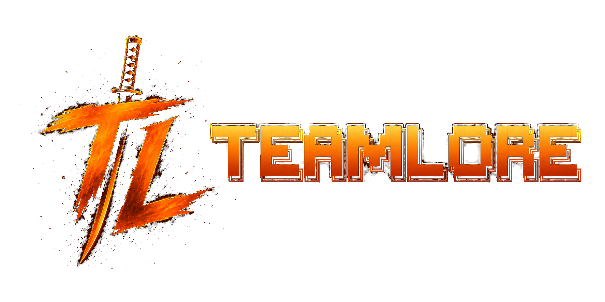
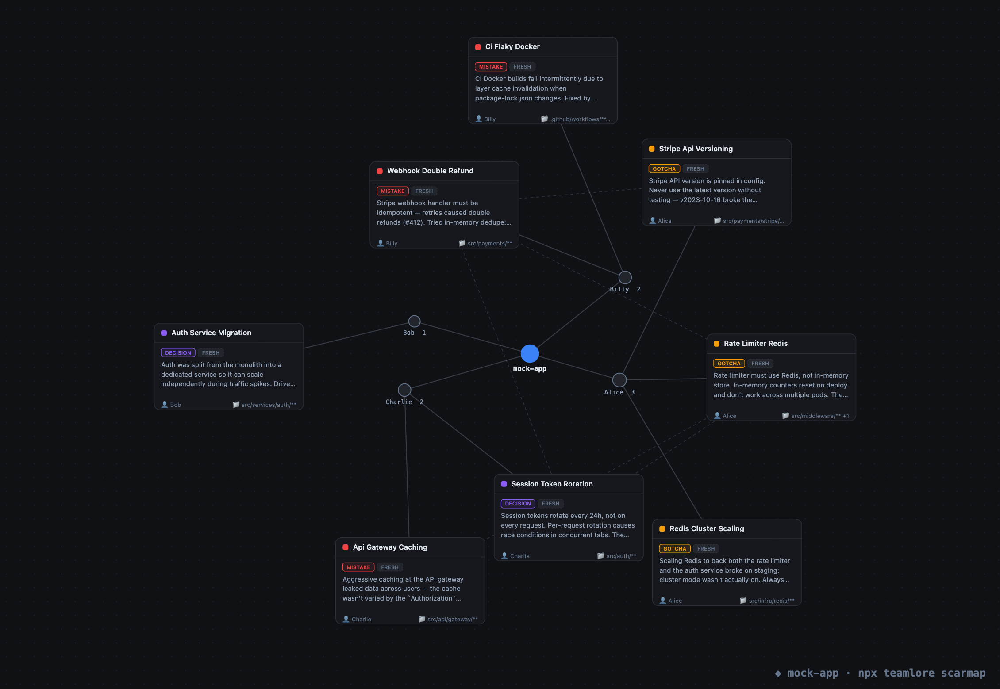

<p align="center">
  <a href="https://github.com/lak7/teamlore">
    
  </a>
</p>

<p align="center">
  <a href="https://www.npmjs.com/package/teamlore">
    
  </a>
  
  = 18" />
  <a href="https://opensource.org/licenses/MIT">
    
  </a>
</p>

<p align="center">
  <strong>Break things only once.</strong> Shared memory for your team's agents —
  Claude Code, Cursor, ZCode, Kimi Code, OpenCode. One dev's agent learns a
  lesson, every teammate's agent remembers it.
</p>

<p align="center">
  
</p>

## Table of Contents

- [teamlore](#teamlore)
- [Why teamlore](#why-teamlore)
- [scarmap — see the scars move](#scarmap--see-the-scars-move)
- [How it works](#how-it-works)
- [Supported agents](#supported-agents)
- [Getting Started](#getting-started)
  - [Requirements](#requirements)
  - [Install](#install)
  - [What each host gets](#what-each-host-gets)
  - [Uninstall](#uninstall)
- [The lore contract](#the-lore-contract)
- [Lore is code — review it](#lore-is-code--review-it)
- [Our own brain](#our-own-brain)
- [Telemetry](#telemetry)
- [Roadmap](#roadmap)
- [License](#license)

## teamlore

teamlore is **shared memory for your team's agents** — Claude Code, Cursor,
ZCode, Kimi Code, and OpenCode. Agents distill hard-won lessons into small,
reviewable files in a `.lore/` folder; every teammate's agent recalls them
automatically when they touch the relevant code.

No server. No accounts. No embeddings. The brain is a folder in git —
onboarding a teammate is `git pull`.

```bash
npx teamlore init
```

## Why teamlore

Monday: Billy's agent causes double refunds. She fixes it.
Tuesday: your agent opens the same file — and almost does it again.
The lesson existed. It was trapped in her session history.

teamlore ends that. One agent distills the lesson into a small lore file.
Every teammate's agent recalls it. When it stops a repeat, the terminal says so:

```
⚡ teamlore — your team already learned this.

   billy · 3 days ago · mistake · src/payments/**
   "Stripe webhook retries caused double refunds (#412).
    In-memory dedupe fails across pods. Use processed_events."

   break things only once.
```

teamlore is built for teams that want their agents to **compound knowledge
instead of repeating mistakes**. It helps you:

- **Capture lessons at the moment they're learned** — corrections, surprising
  failures, decisions with a stated why
- **Recall them exactly where they matter** — path-scoped, never a full dump
- **Keep humans in control** — every memory is reviewed and merged like code
- **See the whole picture** — render the brain as a living scar map

## scarmap — see the scars move

```bash
npx teamlore scarmap
```

One command renders `.lore/` as a **living scar map** — a force-directed
graph that settles in front of you, in your browser. Every node is a lesson,
sized by severity (mistake > gotcha > decision) and colored by decay
(fresh → stale). Every edge is a **real relationship** — overlapping paths,
shared commits, explicit links. No embeddings, no word-similarity guesses:
if two scars are connected, it's because the repo says so.

Click a scar for the full story. Flip to the tree view for risk density by
directory. Export a watermarked PNG in one click and drop it in a standup,
a README, or a tweet — the image is the pitch.

Offline, zero network calls, one self-contained HTML file. No server,
no accounts, ever.

## How it works

**Distill.** Your agent turns hard lessons into tiny lore files —
when you correct it, when a command breaks unpredictably, or when a
decision is made with a stated reason.

**Recall.** Teammates' agents load matching lore automatically. Path-scoped,
~800 tokens, max 5 entries. Never a full dump. Zero matches inject nothing —
silence is a feature.

**Review.** Lore rides the PR. Humans merge. Nothing enters the brain
unreviewed.

**See.** `npx teamlore scarmap` turns the brain into a living scar map —
where the danger zones are, what's fresh, what's gone stale.

**One brain, five agents.** The `.lore/` contract never changes. An adapter
per host wires recall in — hooks first, and a rules + `AGENTS.md` fallback
where a host can't inject. See [Supported agents](#supported-agents).

## Supported agents

Same brain, five hosts. Each adapter installs only what its host can actually
use, and every install is marker-scoped — your existing hooks, keys, and
comments are never touched.

| Host | In the repo (committed) | On your machine (consent only) | Recall mechanism | Support |
|---|---|---|---|---|
| Claude Code | `.claude/skills/teamlore/` · hooks in `.claude/settings.json` | — | injected at session start and on every prompt; Stop gate nudges distill | `verified (script-level)` · live-app untested on CI |
| Cursor | shares `.claude/skills/teamlore/` · hooks in `.cursor/hooks.json` · rule `.cursor/rules/teamlore.mdc` | — | injected at session start; the always-apply rule + `AGENTS.md` cover the rest | `verified (script-level)` · best-effort — live-app untested |
| ZCode | `.zcode/skills/teamlore/` | `~/.zcode/skills/teamlore/` · hooks in `~/.zcode/cli/config.json` | injected at session start and on every prompt (user-level hooks fire in every repo; silenced without `.lore/`) | `verified (script-level)` · best-effort — live config-write + hook-command verified; session-level unobserved |
| Kimi Code | `.kimi-code/skills/teamlore/` | `~/.kimi-code/skills/teamlore/` · hook in `~/.kimi-code/config.toml` | injected on every prompt — Kimi cannot inject at session start | `verified (script-level)` · best-effort — live TOML merge (byte-exact restore) + hook-command verified; session-level untested |
| OpenCode | `.opencode/plugins/teamlore.js` · shares `.claude/skills/teamlore/` | — | in-process plugin: session digest on your first message, then recall on every prompt | `verified (script-level)` · best-effort — live boot clean; plugin execution unverified (needs provider auth) |

Selecting any non-Claude host also adds a marker-guarded section to
`AGENTS.md` — the universal fallback every host can read.

`verified (script-level)` means the host's artifacts and hook payloads are
exercised by the committed suite — `node test/run.js` — on Windows. It does
**not** mean a human watched teamlore run inside the app: no host has a
live-app pass yet (see the statuses above, and the honest per-host limits
[below](#what-each-host-gets)).

Support classifications reflect our verification matrix; host APIs move fast —
re-run `npx teamlore --version` (>= 0.3) and check the docs if a hook stops
firing.

## Getting Started

### Requirements

- **Node ≥ 18** (already required to run `npx teamlore`).
- **A git repo** — the brain syncs and reviews through git.
- **At least one supported agent** — Claude Code, Cursor, ZCode, Kimi Code,
  or OpenCode ([Supported agents](#supported-agents)).
- Hook scripts are plain Node (no bash/jq dependency). They run on macOS,
  Linux, and Windows.

### Install

In the root of a git repo:

```bash
npx teamlore init
git add -A && git commit -m "Add teamlore"
```

Teammates get the brain on their next `git pull`. Each host picks up its
committed artifacts automatically.

Bare `init` installs **Claude Code always** (backward-compatible), plus the
project-level parts of every other host it detects (`.cursor/`, `.zcode/`,
`.opencode/`, `.kimi-code/` markers). Machine-global parts are never touched
without explicit consent. `init` is idempotent. Safe to re-run. It never
clobbers existing hooks or settings.

When it detects ZCode or Kimi Code, `init` prints an instruction row instead
of wiring hooks — those live in user-level config and need your say-so:

```
!  ZCode detected — wire its hooks: npx teamlore init --agents zcode (edits ~/.zcode/cli/config.json)
```

To choose hosts explicitly:

```bash
npx teamlore init --agents cursor,zcode   # exactly these — claude is not implicit
npx teamlore init --agents all            # all five
```

Naming a host is consent for its machine-global writes; `init` prints an
amber warning before editing your user config (`zcode — editing user-level
~/.zcode/cli/config.json`). Hooks wired at user level fire in **every repo on
the machine** — teamlore's scripts exit 0 silently the moment a repo has no
`.lore/`, so non-teamlore repos never notice.

What `init` wires, verbatim, per host:

**Claude Code** — `.claude/settings.json`:

```
node "$CLAUDE_PROJECT_DIR/.claude/skills/teamlore/scripts/recall.js" session    # SessionStart
node "$CLAUDE_PROJECT_DIR/.claude/skills/teamlore/scripts/recall.js" prompt     # UserPromptSubmit
node "$CLAUDE_PROJECT_DIR/.claude/skills/teamlore/scripts/distill-check.js"     # Stop
```

**Cursor** — `.cursor/hooks.json` (root-relative; Cursor runs project hooks
from the project root):

```
node ".claude/skills/teamlore/scripts/recall.js" session --host cursor    # sessionStart
node ".claude/skills/teamlore/scripts/distill-check.js" --host cursor     # stop
```

**ZCode** — `~/.zcode/cli/config.json` (`<home>` = your home dir, absolute,
forward slashes):

```
node "<home>/.zcode/skills/teamlore/scripts/recall.js" session --host zcode    # SessionStart
node "<home>/.zcode/skills/teamlore/scripts/recall.js" prompt --host zcode     # UserPromptSubmit
node "<home>/.zcode/skills/teamlore/scripts/distill-check.js" --host zcode     # Stop
```

**Kimi Code** — `~/.kimi-code/config.toml` (one stanza, appended at EOF):

```toml
[[hooks]]
event = "UserPromptSubmit"
command = "node \"<home>/.kimi-code/skills/teamlore/scripts/recall.js\" prompt --host kimi"
```

**OpenCode** — no commands. The plugin runs in-process and spawns the same
Node scripts itself.

### What each host gets

**Claude Code** — the unchanged trio: skill + scripts in
`.claude/skills/teamlore/`, three hooks in `.claude/settings.json`, and a
`.gitignore` line keeping the `.needs-distill` sentinel out of git. Full
recall at session start and on every prompt, plus the Stop gate.

**Cursor** — `sessionStart` + `stop` hooks merged marker-safe into
`.cursor/hooks.json`, the always-apply rule `.cursor/rules/teamlore.mdc`, and
it shares the `.claude/skills/teamlore/` skill (Cursor reads `.claude/skills`
natively). Known limits: Cursor has no per-prompt injection channel, and
cloud agents skip `sessionStart` — the always-apply rule covers both.

**ZCode** — a project skill at `.zcode/skills/teamlore/`; with consent, hooks
merged into `~/.zcode/cli/config.json` (sets `hooks.enabled: true` only when
it's absent) plus a user-level skill copy. ZCode ignores project-level hooks,
so user-level config is the only channel — that's why its wiring is
machine-global.

**Kimi Code** — project + user skill copies; with consent, a single
`[[hooks]]` stanza appended to `~/.kimi-code/config.toml`. Kimi's
`SessionStart` is observation-only, and a Stop hook would force the model to
keep talking — so recall rides `UserPromptSubmit` only. Your first prompt
carries the session digest.

**OpenCode** — `.opencode/plugins/teamlore.js`, an in-process plugin that
delegates to the same committed Node scripts. Recall lands on your first
message (session digest) and on every prompt after. Honest limitation:
OpenCode has no Stop injection channel, so the distill nudge arrives with
your next message instead of at turn end.

### Uninstall

```bash
npx teamlore remove
```

`remove` ignores host selection and unwinds **every host it finds**:
project artifacts by markers, machine-global entries by scanning your user
configs for teamlore's hook marker. Anything that isn't teamlore's — other
hooks, keys, comments — stays byte-identical.

Note for ZCode/Kimi: removing machine-global wiring unwinds it for the
**whole machine** — that's where it was installed. Re-run
`npx teamlore init --agents <host>` any time to restore.

Your `.lore/` folder is kept — it holds your team's real, committed memories.
To delete everything including the lore and `.loreignore`:

```bash
npx teamlore remove --purge
```

## The lore contract

One lore. One file. ≤120 words. Reviewed like code.

```markdown
---
paths: [src/payments/**]        # glob(s) that make this lore relevant
kind: mistake                   # mistake | gotcha | decision
by: Billy                       # git user who learned it
commit: abc123                  # short HEAD when learned (anchors staleness)
verify_by: 2026-10-01           # soft expiry (~+90 days)
---
Stripe webhook handler must be idempotent — retries caused double refunds
(#412). Tried in-memory dedupe: fails across pods. Use the processed_events
table instead.
```

- Filename `YYYY-MM-DD-slug.md`. One memory per file. Merge conflicts stay rare.
- `paths` scopes recall. Keep globs tight.

## Lore is code — review it

Lore is **proposed by an agent** and **merged by a human**, in a PR, exactly like
code. Nothing enters the shared brain without review. That review is the trust and
security boundary. It's what stops a bad or **poisoned** instruction from becoming
something every teammate's agent obeys. The skill stages lore with `git add` and
never commits. The human always merges.

## Our own brain

teamlore keeps its own `.lore/`. Every mistake the agents made building this
tool, as reviewable git history. Read it in the repo.

## Telemetry

teamlore collects minimal anonymous CLI usage telemetry: command name, outcome,
duration, package version, Node version, platform, architecture, and a random
anonymous ID stored on your machine. It does not collect project content, prompts,
file paths, repo names, git remotes, usernames, hostnames, environment variables,
or stack traces. The `--agents` host list is not recorded.

Disable telemetry with either:

```bash
TEAMLORE_TELEMETRY_DISABLED=1 npx teamlore init
```

or:

```bash
DO_NOT_TRACK=1 npx teamlore init
```

## Roadmap

v0.2 — the skill-and-folder release. Path-scoped grep recall, plus
`teamlore scarmap` — the living scar map of your team's lore.

v0.3 — the cross-agent release. Same brain, five hosts: Claude Code, Cursor,
ZCode, Kimi Code, and OpenCode — an adapter layer, `init --agents`, and an
`AGENTS.md` fallback. **Shipped.**

Still planned:

- `teamlore stale` — surface lore past its `verify_by` date
- `teamlore stats` — the "dodges" receipts: how many repeats the brain prevented

## License

This project is licensed under the MIT License — see the [LICENSE](LICENSE)
file for details.

---

<p align="center">
  <strong>Break things only once.</strong>
</p>
