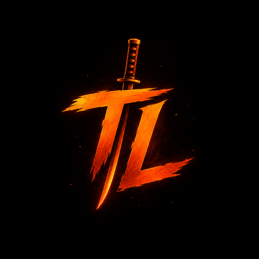
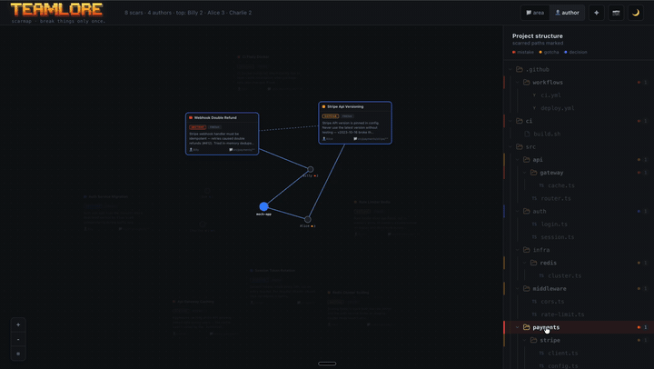

<p align="center">
  <a href="https://github.com/lak7/teamlore">
    
  </a>
</p>

<p align="center">
  <a href="https://www.npmjs.com/package/teamlore">
    
  </a>
  
  = 18" />
  <a href="https://opensource.org/licenses/MIT">
    
  </a>
</p>

<p align="center">
  <strong>Break things only once.</strong> Shared memory for your team's Claude Code —
  one dev's agent learns a lesson, every teammate's agent remembers it.
</p>

<p align="center">
  
</p>

## Table of Contents

- [teamlore](#teamlore)
- [Why teamlore](#why-teamlore)
- [scarmap — see the scars move](#scarmap--see-the-scars-move)
- [How it works](#how-it-works)
- [Getting Started](#getting-started)
  - [Requirements](#requirements)
  - [Install](#install)
  - [Uninstall](#uninstall)
- [The lore contract](#the-lore-contract)
- [Lore is code — review it](#lore-is-code--review-it)
- [Our own brain](#our-own-brain)
- [Telemetry](#telemetry)
- [Roadmap](#roadmap)
- [License](#license)

## teamlore

teamlore is **shared memory for your team's Claude Code**. Agents distill
hard-won lessons into small, reviewable files in a `.lore/` folder; every
teammate's agent recalls them automatically when they touch the relevant code.

No server. No accounts. No embeddings. The brain is a folder in git —
onboarding a teammate is `git pull`.

```bash
npx teamlore init
```

## Why teamlore

Monday: Billy's Claude causes double refunds. She fixes it.
Tuesday: your Claude opens the same file — and almost does it again.
The lesson existed. It was trapped in her session history.

teamlore ends that. One agent distills the lesson into a small lore file.
Every teammate's agent recalls it. When it stops a repeat, the terminal says so:

```
⚡ teamlore — your team already learned this.

   billy · 3 days ago · mistake · src/payments/**
   "Stripe webhook retries caused double refunds (#412).
    In-memory dedupe fails across pods. Use processed_events."

   break things only once.
```

teamlore is built for teams that want their agents to **compound knowledge
instead of repeating mistakes**. It helps you:

- **Capture lessons at the moment they're learned** — corrections, surprising
  failures, decisions with a stated why
- **Recall them exactly where they matter** — path-scoped, never a full dump
- **Keep humans in control** — every memory is reviewed and merged like code
- **See the whole picture** — render the brain as a living scar map

## scarmap — see the scars move

```bash
npx teamlore scarmap
```

One command renders `.lore/` as a **living scar map** — a force-directed
graph that settles in front of you, in your browser. Every node is a lesson,
sized by severity (mistake > gotcha > decision) and colored by decay
(fresh → stale). Every edge is a **real relationship** — overlapping paths,
shared commits, explicit links. No embeddings, no word-similarity guesses:
if two scars are connected, it's because the repo says so.

Click a scar for the full story. Flip to the tree view for risk density by
directory. Export a watermarked PNG in one click and drop it in a standup,
a README, or a tweet — the image is the pitch.

Offline, zero network calls, one self-contained HTML file. No server,
no accounts, ever.

## How it works

**Distill.** Your agent turns hard lessons into tiny lore files —
when you correct it, when a command breaks unpredictably, or when a
decision is made with a stated reason.

**Recall.** Teammates' agents load matching lore automatically. Path-scoped,
~800 tokens, max 5 entries. Never a full dump. Zero matches inject nothing —
silence is a feature.

**Review.** Lore rides the PR. Humans merge. Nothing enters the brain
unreviewed.

**See.** `npx teamlore scarmap` turns the brain into a living scar map —
where the danger zones are, what's fresh, what's gone stale.

## Getting Started

### Requirements

- **Node ≥ 18** (already required to run `npx teamlore`).
- **Claude Code** with skills + hooks support.
- Hook scripts are plain Node (no bash/jq dependency). They run on macOS,
  Linux, and Windows.

### Install

In the root of a git repo:

```bash
npx teamlore init
git add -A && git commit -m "Add teamlore"
```

Teammates get the brain on their next `git pull`. Claude Code picks
up the committed skill and hooks automatically.

`init` is idempotent. Safe to re-run. It never clobbers existing
hooks or settings.

### Uninstall

```bash
npx teamlore remove
```

This deletes the skill and unwires the three hooks from `.claude/settings.json`
(leaving any other hooks and settings untouched). It **keeps your `.lore/`
folder** — it holds your team's real, committed memories. To delete everything
including the lore and `.loreignore`:

```bash
npx teamlore remove --purge
```

## The lore contract

One lore. One file. ≤120 words. Reviewed like code.

```markdown
---
paths: [src/payments/**]        # glob(s) that make this lore relevant
kind: mistake                   # mistake | gotcha | decision
by: Billy                       # git user who learned it
commit: abc123                  # short HEAD when learned (anchors staleness)
verify_by: 2026-10-01           # soft expiry (~+90 days)
---
Stripe webhook handler must be idempotent — retries caused double refunds
(#412). Tried in-memory dedupe: fails across pods. Use the processed_events
table instead.
```

- Filename `YYYY-MM-DD-slug.md`. One memory per file. Merge conflicts stay rare.
- `paths` scopes recall. Keep globs tight.

## Lore is code — review it

Lore is **proposed by an agent** and **merged by a human**, in a PR, exactly like
code. Nothing enters the shared brain without review. That review is the trust and
security boundary. It's what stops a bad or **poisoned** instruction from becoming
something every teammate's agent obeys. The skill stages lore with `git add` and
never commits. The human always merges.

## Our own brain

teamlore keeps its own `.lore/`. Every mistake Claude made building this
tool, as reviewable git history. Read it in the repo.

## Telemetry

teamlore collects minimal anonymous CLI usage telemetry: command name, outcome,
duration, package version, Node version, platform, architecture, and a random
anonymous ID stored on your machine. It does not collect project content, prompts,
file paths, repo names, git remotes, usernames, hostnames, environment variables,
or stack traces.

Disable telemetry with either:

```bash
TEAMLORE_TELEMETRY_DISABLED=1 npx teamlore init
```

or:

```bash
DO_NOT_TRACK=1 npx teamlore init
```

## Roadmap

v0.2 — the skill-and-folder release. Path-scoped grep recall, plus
`teamlore scarmap` — the living scar map of your team's lore. No server,
no embeddings. Planned fast-follows:

- `teamlore stale` — surface lore past its `verify_by` date
- `teamlore stats` — the "dodges" receipts: how many repeats the brain prevented
- Cross-agent adapters — built for Claude Code; Cursor & Codex next

## License

This project is licensed under the MIT License — see the [LICENSE](LICENSE)
file for details.

---

<p align="center">
  <strong>Break things only once.</strong>
</p>
